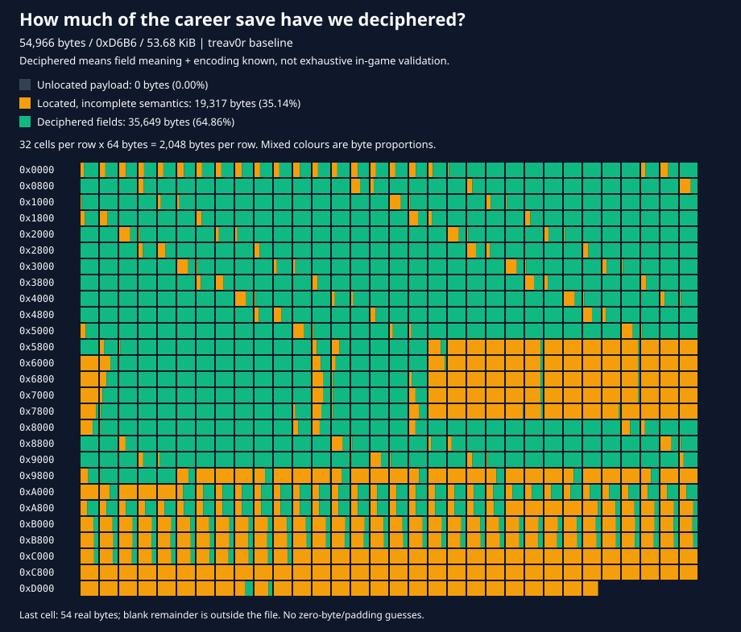

# NFSU2 Savegame Editor

A browser-based career save editor for Need for Speed: Underground 2 (`SPEED2.EXE` saves, 54,966-byte `20CM` files). It also opens [nfsu2-web](https://github.com/th0mk/nfsu2-web) save-folder backup ZIPs, including their 10-slot `GARAGE.DAT` garages. Everything runs locally in the browser. Nothing is uploaded.

The live site is deployed to GitHub Pages from `main`. See [doc.md](doc.md) for what we know about the save format.

## Savefile discovery map



The reference career save is **54,966 bytes (`0xD6B6`, 53.68 KiB)**. Read the grid left to right, top to bottom: each cell represents **64 bytes**, each row **2,048 bytes**. Mixed cells show the exact proportions of the three states, not a whole-cell approximation.

| Evidence state | Bytes | File coverage |
| --- | ---: | ---: |
| Deciphered: field meaning and encoding known | 37,225 | **67.72%** |
| Located inside a known structure, semantics incomplete | 17,741 | **32.28%** |
| Payload not assigned to a specific structure/field | 0 | **0.00%** |
| **Located in total (includes deciphered)** | **54,966** | **100.00%** |

This is a conservative, byte-weighted inventory of current repository evidence, **not a percentage of game features implemented or exhaustively verified in-game**. The header's two block boundaries locate the outer container only; they do not make all its payload "discovered."

| Located structure | Absolute range (end exclusive) | Size | Deciphered bytes |
| --- | --- | ---: | ---: |
| Header | `0x0000`–`0x001C` | 28 | 28 |
| Block A compatibility descriptor | `0x001C`–`0x0024` | 8 | 8 |
| Stock catalogue and active count | `0x0024`–`0x04A8` | 1,156 | 772 |
| 20 generic configurations | `0x04A8`–`0x5868` | 21,440 | 20,180 |
| Five native career car records | `0x5868`–`0x8022` | 10,170 | 5,115 |
| Garage-record count | `0x8022`–`0x8026` | 4 | 4 |
| Six special configurations | `0x8026`–`0x995E` | 6,456 | 6,054 |
| Special-configuration count | `0x995E`–`0x9962` | 4 | 4 |
| Eight stage records | `0x9962`–`0xA16A` | 2,056 | 1,800 |
| Career scalars and 384 event records | `0xA16A`–`0xAE9A` | 3,376 | 1,932 |
| 256 SMS inbox records and controls | `0xAE9A`–`0xC2A3` | 5,129 | 1,288 |
| Career tail | `0xC2A3`–`0xC447` | 420 | 0 |
| Profile copy spans | `0xC447`–`0xD225` | 3,550 | 0 |
| Driver-name field | `0xD225`–`0xD245` | 32 | 32 |
| Auxiliary tail object | `0xD245`–`0xD278` | 51 | 8 |
| Six identity-matched runtime-state records | `0xD278`–`0xD6B6` | 1,086 | 0 |

Each career garage record contributes **1,023 deciphered bytes**: its native slot handle (4), enumeration/type/initialization dwords (12), identity hash (4), 170 visual hashes (680), nine unique-performance flags (36), 68 installed-item positions (68), five dyno setups (205), lock/bought flags (2), first eight ownership bytes (8), and ordinary purchase-price accumulator (4). Visual hashes include derived/unused slots; deciphering their stored representation does not mean every slot is independently editable.

**First 4 KiB traced (2026-11-05):** `0x0000`–`0x0FFF` remains **100% structurally located**, with **3,534 bytes deciphered (86.28%)** and **562 bytes still semantically incomplete (13.72%)**. It contains the container, a compatibility descriptor, 48 stock catalogue records and the beginning of 20 generic saved car configurations—not the career garage slots. See [the field-by-field trace](technical.md#first-4-kib-trace-2026-11-05).

**Whole-file first pass:** internal native serializers now account for every byte through EOF, including all repeating configurations, stages, events, SMS messages and tail blocks. Original x86 collection/profile/tail instructions passed fixture or constrained synthetic routing checks; the career loader intentionally resets four transient dwords, and the SMS loader compacts unresolved definitions and recomputes counts. See [the boundary ledger, normalization rules and validation limits](technical.md#whole-file-first-pass-2026-11-05). Structural coverage is not complete semantic understanding.

**Important correction:** `0xA175` is the **uint32 current career-stage index**, not a garage count. The actual garage-record count is at `0x8022`. Car replacement now preserves the stage field; its old low-byte write has been removed.

The 420 category-unlock offsets are **sparse**, not a contiguous table. Eight overlap the mapped performance ownership bytes; the remaining 412 per car stay amber because individual-part semantics are not established. The ninth ownership byte also stays amber because its visual-purchase interpretation is unverified. Donor-copy blocks, record gaps and zero-filled bytes are not automatically counted as deciphered. The fixed event array has **384 entries**, of which 137 are active in the reference: each name hash (`+0`) and traced status byte (`+6`) is green, while three bytes per entry remain amber. Shop discovery at `+4` is now verified for shop hashes, but is not promoted across the whole mixed event array: non-shop meanings still need tracing. Status values are not universal completion/unlock flags.

Scope: the repository's `testfile/treav0r` career file, including empty car records; separate ZIP/GARAGE.DAT bytes are excluded. Evidence comes from [layout constants](src/model/layout.ts), [save validation](src/model/save-file.ts), [performance mappings](src/model/perf.ts), [dyno layouts](src/model/dyno.ts), [unlock ranges](src/data/unlock-table.ts), and the serializer/event traces in [technical.md](technical.md). Byte coverage counts overlapping interpretations only once.

Regenerate after updating the evidence ranges in [scripts/save-coverage.mjs](scripts/save-coverage.mjs):

```sh
npm run build
node scripts/save-coverage.mjs
```

The generator checks the reference file's structure and checksums, compatibility descriptor, stock count/index sequence, event capacity and first-4-KiB totals. It requires contiguous internal block boundaries through EOF, rejects invalid/duplicate evidence ranges, emits per-block totals, and verifies that the grid accounts for every byte exactly once.

## Features

- Edit driver name and money, with checksums recalculated on download.
- Career access (experimental): stage selector **0–6**, progression-safe shop discovery, and a separate **Complete career (100%)** action using local `GLOBALB.BUN`. Full completion intentionally changes real event/photo goals and stage results; does not fabricate money, cars or reward ownership. Completed race/photo markers disappear. Dealer-car/part gates are also reported.
- Open a raw career save or an nfsu2-web backup ZIP; the file type is detected from its contents.
- View each car slot's make and model, read from the car type hash.
- Replace or add a car in a slot. Tuning is kept.
- Edit mapped performance parts and separate unique-performance flags.
- Body, paint, four vinyl layers and their colours, decals, lighting, trunk audio, specialties and custom dials from your local game's part catalogue, filtered for the selected car.
- Dyno: simulate peak power and torque, 0–60, 0–100, quarter mile and top speed per setup (metric and imperial side by side), edit the ECU and turbo graphs and the gear ratios like the game's tuning screens, and auto-tune them (needs your game's `GLOBALB.BUN`).
- Remaining dyno menus: suspension/steering, front/rear aerodynamics, tires/brake bias and coupled nitrous duration/flow, with installed-part ranges and defaults.
- Swap slots (experimental) and unlock all slots.

## Development

Requirements: Node.js 24 or newer.

```
npm ci
npm run build    # compiles src/ to dist/ and copies static files
npm test         # build, then run the test suite
npm run clean    # remove dist/
```

Each build stamps the header with the package version and a UTC build number (`YYYYMMDDhhmmss`). The splash label lives in `index.html`; update it for the next feature milestone.

The source layout is:

- `src/model/`: save parsing and editing logic, with no DOM access.
- `src/data/`: static tables (performance parts, unlock ranges).
- `src/controller/`: the AngularJS controller, scope types, and file-input directive.
- `src/main.ts`: AngularJS bootstrap.
- `src/test/`: tests.

AngularJS 1.8.2 is loaded from a CDN in `index.html`.

## Running locally

The editor fetches `car-donors.json`, so it must be served over HTTP rather than opened from disk. After `npm run build`, serve `dist/`:

```
cd dist
python -m http.server 8765
```

Then open `http://127.0.0.1:8765/index.html`.

## Deployment

`.github/workflows/deploy.yml` runs the tests and builds on every push to `main`, then deploys `dist/` to GitHub Pages. In the repository settings, set **Pages > Build and deployment > Source** to **GitHub Actions** once.

## Usage

1. Choose a career save (for example `treav0r`) or an nfsu2-web backup ZIP. Files are read in the browser and never uploaded. For a ZIP, choose the profile to edit.
2. Edit the driver name and money, then click **Apply profile**.
3. Filled car slots show their make and model, identified by the car type hash at slot offset `+0x014`. Hashes absent from the donor list show as unknown; locked/open slots hide the car name.
4. **Replace car** (or **Add car** for an empty slot) writes a donor car's slot blocks. Tuning is kept.
5. Open **Tuning**. Load your game's `GLOBAL\GLOBALB.BUN` once for **Body parts**, **Graphics**, **Specialties** and **Dyno**. Choose a category, edit its controls, then **Apply visual changes** or **Apply** the dyno draft. Discard leaves the saved values unchanged.
6. Click **Download edited save** or **Download edited ZIP**. Checksums are recalculated on download.

## nfsu2-web backups

The editor recognizes ZIP files by their signature, not their extension. Profiles are entries named `<profile>/<profile>` that pass the normal `20CM` checks, normally under `NFS Underground 2/`. A profile with a matching `GARAGE.DAT` shows ten car slots: slots 1–5 from the career save and slots 6–10 from `GARAGE.DAT`. A profile without one shows the normal five slots.

The first five slots use exactly the same layout in a ZIP profile and a standalone career file. A separate export can contain different cars or ownership flags even with the same profile name; loading a ZIP does not merge it with other exports. Unowned records can retain old car identities, but are correctly shown as empty.

nfsu2-web pairs `GARAGE.DAT` with its profile through a fingerprint of the career save's car data. Downloading a ZIP recalculates every edited career save's checksums, writes edited slots 6–10 back to `GARAGE.DAT` and updates its fingerprint. Other entries, including `GARAGE.OLD`, settings and registry files, keep their bytes and timestamps. A `GARAGE.DAT` that is invalid or does not match its career save is left unchanged and its extra slots are not shown, as nfsu2-web would not load it.

## Notes

- `car-donors.json` is a copy of the donor table from GabriLex's `nfsu2profilemaster`. It contains each car's per-slot blocks, plus save-wide blocks that the editor ignores.
- **Replace car** resets the slot's appearance before writing its donor blocks (`+0x000`, `+0x0E0`, `+0x2B0`), then clears vinyl layers/colours, decal textures and neon (including the cabin frame). Installed performance flags reset to stock; dyno setups are kept. Empty slots no longer copy another car's appearance. Save-wide donor blocks are not touched. Test in game before relying on it.
- Variants with the same car type hash (base, sponsor and intro versions) show the first name listed. The separate `+0x2BC` model key is not used for names: different cars such as Sentra, Golf and Tiburon share it.
- **Swap (experimental)** exchanges the car data of two slots, including slots 6–10 in an nfsu2-web backup. Each slot keeps its own native `CAREER_SLOT_<n>` handle, and the neighboring slot is not touched. Other save references are not updated. It has not been tested in-game.
- **Tuning** shows performance part names and ordinary packages, without internal keys, offsets, prices or purchase-bit details. Inactive parts are disabled and visual-related flags are not shown. Technical mappings are recorded in [technical.md](technical.md).
- **Visual customization** reads the actual database names, palettes and per-car compatibility from your own archive; no game assets or complete part catalogue are bundled. Paint swatches show raw RGB, not the game's material/lighting result. Four vinyl layers each have four colour slots. Dials have a style plus backing, needle and character colours. Linked wheels, under-hood geometry, widebody door/decal geometry, carbon/vinyl exclusions and stock audio-component resets follow the traced setters. Body changes also rebuild the twelve visual-derived aero flags. Unknown installed hashes are retained. The UI omits game-derived geometry and the eight hood-decal slots ignored by the native visual setter. Shop purchases, money, unlock progression and 3D previews are deliberately not simulated.
- **Colour palettes** use numbered swatches grouped by catalogue family/level. Body, spoiler, roof and mirror paint offer gloss, metallic and pearlescent finishes; engine hoses, exhaust, calipers, rims/spinners and vinyl colours use their own palettes. Dials retain their named colours. Audio paint follows the native unfiltered catalogue. An installed unknown or out-of-category colour is retained until explicitly replaced. Only one picker is expanded at a time, beside the colour targets on wide screens and below them on smaller screens; selections still require **Apply changes**.
- **Visual drafts** span the three visual tabs until applied or discarded. Loading another save/profile, opening another slot, changing game data or applying another save edit discards them; downloading exports only applied changes. Keep an original backup: these controls are based on executable/database traces and byte-round-trip tests, not exhaustive in-game verification of every part combination.
- **Other dyno menus** use the same per-event draft and Apply/Discard as the curves. Nitrous duration and flow are inverse-coupled, not independent boosts. Ride height is displayed in centimetres. Invalid ranges in traffic-car records are disabled explicitly. These values are saved, but their handling, grip, aero and nitrous effects are not simulated by the straight-line result table. They are not searched by auto-tune.
- **MAX OUT** (in the tuning dialog header) enables the 54 active performance bytes, including mutually exclusive parts, and sets the nine unique flags; the game's own apply routine does not do this. It does not change the visual-related flags, purchase bookkeeping or inactive IDs. Only the muffler (15) and cold air intake (16) edits are confirmed by in-game save diffs.
- **Unique** controls edit separate per-car category flags without a confirmation prompt. They do not emulate the unique shop's event-status update or full reward process. See [technical.md](technical.md) for the code trace and evidence limits.
- **Unlock all** sets the 420 bytes that NFSU2-ProfileCreator writes as `0xFF` in each car slot (ranges in [src/data/unlock-table.ts](src/data/unlock-table.ts), offsets `+0x462` to `+0x7E1`). It only writes those bytes. The byte-to-part mapping and the in-game effect are not verified yet.
- **Dyno** (in the tuning dialog) reads car data from `GLOBAL\GLOBALB.BUN` in your NFSU2 folder; the file is read locally and not shipped with the editor. A car needs at least one tunable performance or body package installed. The **ECU** and **Turbo** tabs show the game's 9-point torque graph (idle to redline) with each point's min–max range, stock value and current setting. Click or drag a column, or focus the graph and use the arrow keys (Shift = 10 steps). By default edits follow the game's tuning screen: raising a point also lifts its direct neighbours and lowers the points further away, so the curve's total torque stays the same. **Cheat limits (save-only)** sets each point on its own instead, which only a save edit can do. When the save loads, the game spreads the change in total torque evenly over all nine points, so lowering some points pushes the others past their maximum; dashed **In game** marks show those values, and the result table includes them. The **Drivetrain** tab is the game's Gear Ratios screen: each gear's speed at the rev limiter on a 0–420 km/h bar (green up to the current setting, red for the rest of its range) and the final drive from Top speed to Acceleration. Click or drag a bar, or use −/+ or the arrow keys; like the game, moving a gear pushes its neighbours to keep a 0.05 ratio gap. The ranges come from the installed transmission parts and cannot be unlocked through the save, because the game clamps out-of-range values when it loads. **Auto-tune ECU & turbo** starts from the graph and loads its result into it for manual adjustment; it always sets points independently, so its curves use the cheat limits whether or not the box is checked. Edits are drafts per slot and setup (a **Saved / Edited** comparison) until you **Apply** them; **Discard changes** drops them. Apply writes the selected setup's 18 curve bytes, plus its gearing and scalar bytes when you changed them. Times come from the game's own dyno simulation and are not yet checked against the in-game screen. See [technical.md](technical.md).
- **Optimize gearing & shift spacing** is unchecked by default. Enable it to include unlocked final-drive and forward-gear settings in event tuning. The search checks every shift, including gears outside the timed run, and balances usable power and event performance with average/worst-shift power-band coverage and more even percentage RPM drops. Excessive RPM drops are capped against the neutral transmission and its geometric spacing. This tunes ratios, not the game's shift-RPM thresholds. Apply saves those settings alongside the curves, leaving other setups and unrelated bytes unchanged. Locked and unused gears are preserved. Gearing is frozen during the initial and final usable-power passes. The game's adjacent-gear constraints and byte normalization are included; see [technical.md](technical.md#gearing-trace).
- **Event-specific auto-tuning** replaces the goal slider. Selecting Circuit or URL targets broad usable power through shift recovery, Drag targets sustained high-RPM power and top-speed-biased gearing, and Drift/Street X target low–mid RPM response and acceleration. The [wiki's tuning guidance](https://nfs.fandom.com/wiki/Need_for_Speed:_Underground_2/Performance_Tuning) recommends acceleration for short tracks/drift and top speed for drag; the exact RPM targets are editor heuristics, not prescriptions from the wiki or a lap/drift simulation. The displayed target band is split into three equal RPM regions and their average powers are combined geometrically, so a lone peak cannot substitute for usable power across the band. Auto-tune builds that power, runs two event/performance passes with optional gearing, then refines it with gearing fixed. Final refinement cannot worsen any resulting acceleration time or top/trap speed.

The dashed **In game** marks are the actual final physics components, including unique parts: ECU is total engine torque minus turbo, and Turbo is its own boost component. The load's equal torque correction belongs to ECU only, so parallel movement there is expected; it is an additive offset, not scaling. The stats use the combined engine torque.

**Usable band power** in the comparison table shows the optimization score in kW/hp. The target band stays fixed for each draft, so Saved and Edited use identical RPM limits. An event tune can trade peak HP or straight-line times for stronger power in that band; review the other stats before applying.

## Experimental traffic identities

The **Replace car with** dropdown includes a **Traffic cars (experimental)** group with 15 traffic vehicles, enabled only for filled, unlocked slots. This is an **identity-only experiment**, not a complete donor replacement: it changes only the car type hash, preserving existing body, parts and tuning. Appearance, player driving and career loading are unverified. Traffic replacement applies without confirmation. The game may fail to load the edited save; use a backup. Traffic slots are labeled experimental and DYNO is unavailable. Normal car replacement remains available to restore an ordinary car.

## Tests

```
npm test
```

Fixture tests read `testfile/treav0r` and skip when that file is missing. `testfile/` is gitignored. Dyno tests also need `GLOBALB.BUN`; they use the default install path or `NFSU2_GLOBALB`, and skip when it is missing.
